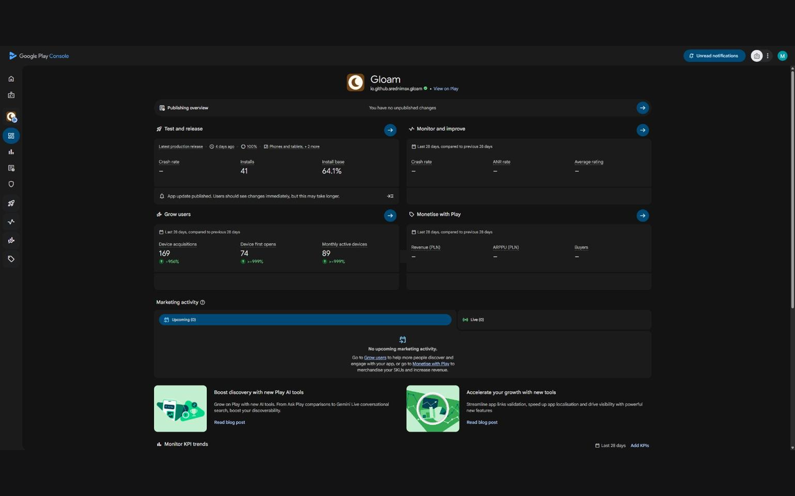
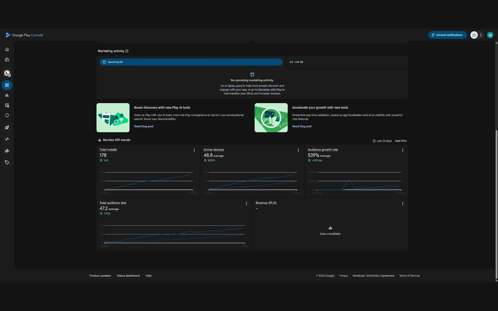

# Dark Theme for Play Console

**A free Chrome extension that turns on a dark mode for the Google Play Console.** No account, no
tracking, no network requests. Unofficial, not affiliated with Google.

## How it works

Play Console already contains a complete dark colour palette. It just has no switch for it. The
extension switches it on and fills in the few places the palette leaves white.

Because it uses Google's own dark colours instead of inverting the page, text, cards, buttons and
charts keep their intended look. The one exception is charts drawn on a white canvas, such as
Statistics, Android vitals and ratings, which are inverted.

## What it does

- **Darkens the whole console.** The dashboard, app pages, statistics, dialogs, menus, tooltips and
  the date picker.
- **Turns on and off with one click.** Click the toolbar icon. Your choice is remembered.
- **Stays out of everything else.** It runs only on `play.google.com/console`.

## Install

Add it from the [Chrome Web Store](https://chromewebstore.google.com/detail/dark-theme-for-play-conso/fgihoebnjomkgmhibmfcefkofiipfnnl).
It works in Chrome and other Chromium browsers that use the Chrome Web Store.

## Known limitations

- Chart axis lines on the app dashboard stay light.
- Google may change Play Console's internals at any time, which could break the theme until the
  extension is updated.

## Help and feedback

Found a screen that's still bright, or something broke? Email
**[playconsoledark.support@maksforge.com](mailto:playconsoledark.support@maksforge.com)**, or
[open an issue](https://github.com/maksforge/play-console-dark-theme/issues).

## Free, with an optional tip

The extension is free and never unlocks anything. If it saves your eyes, you can leave a tip from
the toolbar icon's right-click menu, or on [Buy Me a Coffee](https://buymeacoffee.com/maksforge).

---

Google Play is a trademark of Google LLC. This extension is not made, endorsed or supported by Google.
